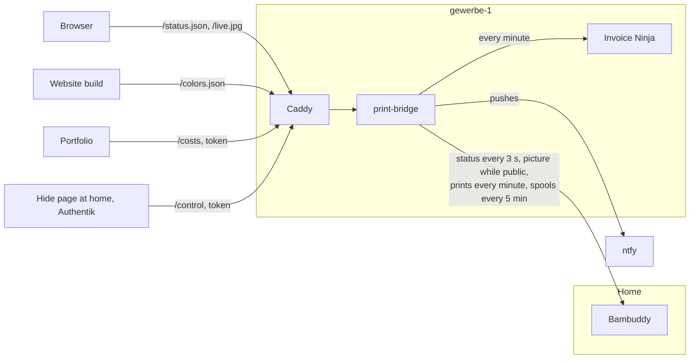

# print-bridge

The one service between the printer's Bambuddy and everything else of 3dbruckner.de. It runs on gewerbe-1 and is the only service that calls Bambuddy, with one read-only API key. Why: [`docs/adr/0001-one-bridge-on-gewerbe-1.md`](docs/adr/0001-one-bridge-on-gewerbe-1.md).

## What it does

**Orders, every minute:**

- **marks approved quotes as waiting:** an approved quote gets Druckstatus `wartet`;
- **follows the print:** it reads the Bambu A1's prints from Bambuddy's archive, and when a print starts, its quote is `im Druck`;
- **finishes the quote:** when the print ends, the quote gets a line with the time and grams, Druckstatus `fertig`, and an invoice **draft**, and Marcel gets a push.

A print finds its quote by the quote's number in its name (`3D-2026-0010 Vase`, or `3D-2026-0010 Vase (2/3)` for part 2 of 3). Without a number, it takes the only quote that is waiting. The bridge sends nothing to a customer and starts no print.

**Live picture, every 3 s:** while a print runs and isn't hidden, visitors get the camera picture and the status, progress and end time, never the job's name. A failed status, a failed camera or a picture older than 30 s reads as "not printing". A running print without a picture for 10 minutes sends one push.

**Hide switch:** `printer-live.herziis.de`, behind the homelab's Authentik, forwards to `/control` with its token. A hidden print stays hidden through a restart and returns to public when it ends.

**Inventory, every five minutes:** the public colours for the site's build, and the average purchase cost per kilogram for the portfolio's signed-in form. Both stay when Bambuddy is away.

## What it serves

| Path                                       | Who                                               | What                                                                     |
| ------------------------------------------ | ------------------------------------------------- | ------------------------------------------------------------------------ |
| `GET /status.json`, `GET /live.jpg`        | Everyone                                          | The live print                                                           |
| `GET /colors.json`                         | Everyone                                          | Colour, material, finish and swatch                                      |
| `GET /costs`                               | Portfolio, with `PRINT_COSTS_TOKEN`               | Average purchase cost per kilogram                                       |
| `GET /control`, `POST /control/visibility` | The hide page's proxy, with `PRINT_CONTROL_TOKEN` | The hide switch                                                          |
| `GET /health`                              | The private network                               | Database, last good minute, and `stale`: the jobs with no recent success |

## Deploying

The compose file is `print-bridge/` in the business stacks, and its settings come from the business's Ansible vault. `.env.example` lists every setting. Keep `print-bridge.sqlite`: it records which prints are handled, and without it old prints could create duplicate quote lines or invoice drafts. Never run two bridges at once.

The design of the order flow: [`docs/superpowers/specs/2026-11-20-print-bridge-design.md`](docs/superpowers/specs/2026-11-20-print-bridge-design.md).

AGPL-3.0-only.
