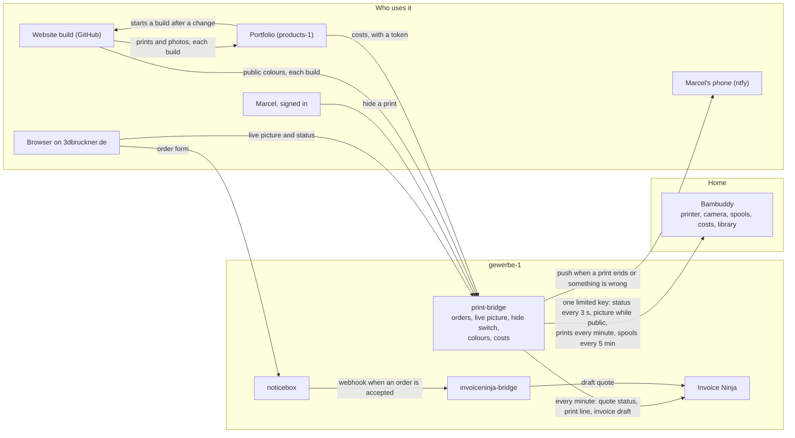

# Vision: one bridge on gewerbe-1

Status: agreed with Marcel on 2026-11-23 and built in 0.3.0. The decision is [ADR 0001](adr/0001-one-bridge-on-gewerbe-1.md).

print-bridge, the homelab's `printer-live` and the live receiver on gewerbe-1 become one service on gewerbe-1. It is the only service that talks to Bambuddy, and everything else gets its printing data from it.

## Who talks to whom

Each arrow points from the side that opens the connection.

## The rule

**No visitor request reaches home, and exactly one service, print-bridge, may call Bambuddy, with one limited key.** This replaces "nothing of 3dbruckner.de reaches into the home network" from the homelab's ADR-0220 and ADR-0270. Bambuddy is already reachable from the internet, so the bridge uses that address and needs no tunnel.

## What changes

- **Merged into print-bridge:** the order tracking, `printer-live` (status, camera picture, hide switch, dead-camera alert) and the live receiver (public picture, status and colours).
- **Removed:** print-bridge and `printer-live` at home, the live receiver, its picture and colour uploads with their tokens, and the portfolio's own connection to Bambuddy with the colours in its export.
- **Keys:** three Bambuddy keys become one.
- **Name:** it stays `print-bridge`, because it now really is the bridge. The rename in #9 is no longer planned.
- **Unchanged:** the website reads prints and photos from the portfolio. noticebox still sends accepted orders by webhook to `invoiceninja-bridge`, with no polling. Selling rates stay in `print-pricing`.

## What must stay true

- Only status, progress and end time are public. A job name, brand, weight, price or note never is.
- Purchase costs reach only the portfolio's signed-in form.
- A dead source never shows stale data as live.
- The live address keeps no access log, as 3dbruckner.de's privacy policy promises.
- The bridge never starts a print and never sends anything to a customer.
- Its data moves intact, so no print creates a duplicate quote line or invoice draft. The old image stays as the way back.

## Checked before building

1. Bambuddy's picture and a 3-second status poll work from gewerbe-1 without Cloudflare or CrowdSec blocking them.
2. One key with "read status" covers status, camera, archive and spools. Real slicing would also need "manage library", so it is left for later.
3. The hide switch can move from the homelab's sign-in to the business one.
4. Print tracking catches up correctly after home was offline.
